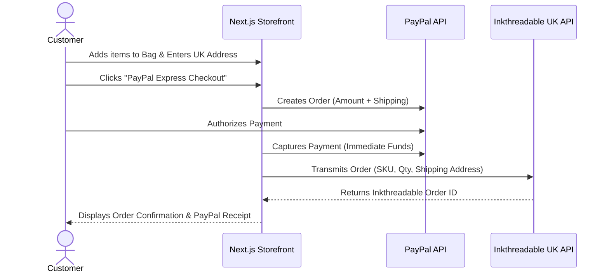

# SWPA Official Merchandise Store

Modern, conversion-optimized, high-end e-commerce platform replacing Shopify, built with Next.js 14, Tailwind CSS, PayPal Smart Checkout, and automated Inkthreadable Print-on-Demand fulfillment.

---

## 🚀 Key Improvements Over Shopify

1. **Zero Payout Delays (No 2-Week Holds):** Payments are captured immediately via **PayPal** directly into your PayPal account balance, allowing automated purchasing on Inkthreadable without cashflow blockages.
2. **Automated Inkthreadable Fulfillment:** As soon as an order is paid via PayPal, the backend automatically calls the **Inkthreadable UK API** with the customer's shipping address and product SKU.
3. **Optimized Pricing:** Every product price has been increased to incorporate:
   - **+£3.00 net profit** per item
   - **PayPal domestic fee (2.9% + £0.30)**
   - Rounded cleanly to `.99` (e.g. £23.99 $\to$ **£28.99**)
4. **Luxury High-End Aesthetics:** Dark mode palette with gold/amber crest accents, high-resolution garment imagery, smooth slide-over cart drawer, and interactive sizing guide.
5. **Direct Cloudflare Deployment:** Zero monthly Shopify software fees.

---

## 🛠️ Configuration (.env.local)

Copy `.env.example` to `.env.local` and configure your credentials:

```bash
# PayPal API Credentials (https://developer.paypal.com/dashboard/)
# Use 'live' for production or 'sandbox' for testing
PAYPAL_ENVIRONMENT=live
PAYPAL_CLIENT_ID=your_live_paypal_client_id
PAYPAL_CLIENT_SECRET=your_live_paypal_client_secret
NEXT_PUBLIC_PAYPAL_CLIENT_ID=your_live_paypal_client_id

# Inkthreadable API (https://www.inkthreadable.co.uk/profile/api)
INKTHREADABLE_APP_ID=your_inkthreadable_app_id
INKTHREADABLE_API_KEY=your_inkthreadable_api_key

# Store Shipping & Thresholds
STORE_CURRENCY=GBP
STANDARD_SHIPPING_FEE=4.99
FREE_SHIPPING_THRESHOLD=60.00
```

---

## 📦 How the Automation Works



---

## 🌐 Deploying to Cloudflare

1. Push this project to GitHub.
2. In the **Cloudflare Dashboard** under **Workers & Pages**:
   - Create a new application $\to$ **Pages** $\to$ Connect to GitHub.
   - Framework preset: **Next.js**.
   - Build command: `npm run build`
   - Add your environment variables in the Cloudflare Pages settings under **Settings > Environment variables**.
3. Under **Custom domains**, add `swpa.uk`. Cloudflare will automatically provision SSL certificates and routing.
